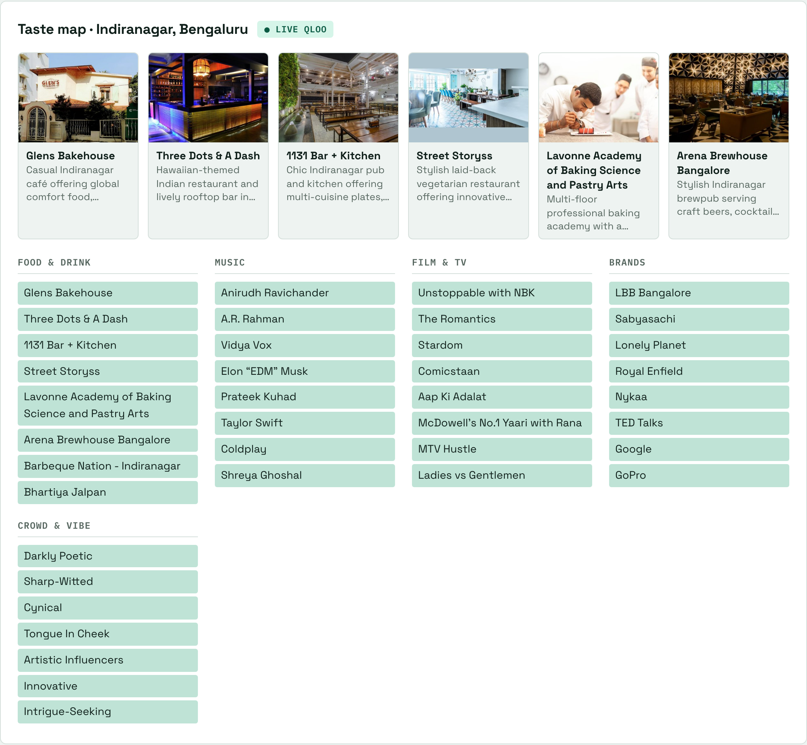
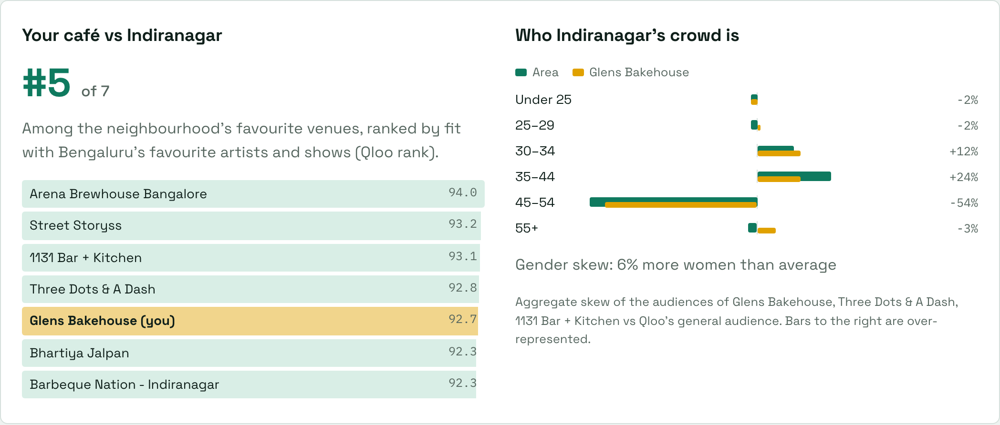
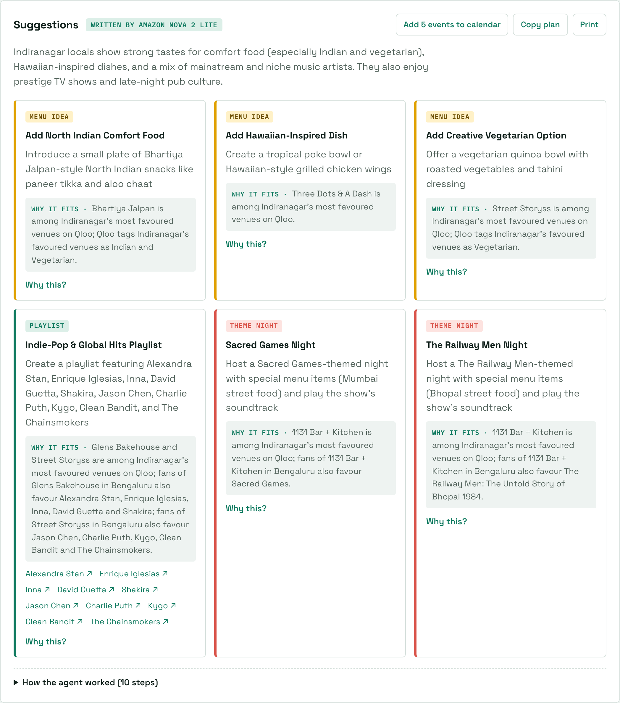
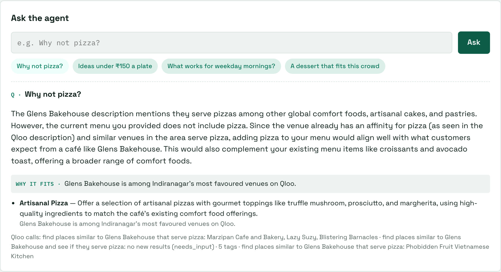
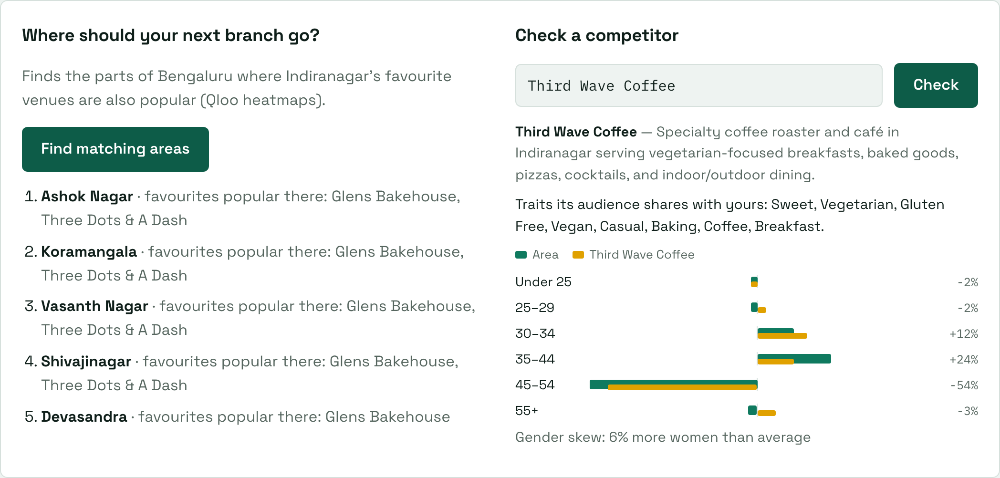

# Localtaste

**Neighbourhood taste research for independent cafés, powered by Qloo.**

Chains pay for market research before they open or change a menu. The independent café on the corner guesses.
Localtaste gives that owner the same kind of insight in 30 seconds: enter the café's address and menu, and an agent
uses [Qloo](https://qloo.com)'s taste graph to work out what the neighbourhood loves, then turns it into a plan they
can run this month: dishes to add, a playlist, theme nights, and where they stand against the local favourites.

**Live demo: https://localtaste.revenuerush.in** (no sign-up; the form is pre-filled, just press *Get taste advice*).

> Built for the [Qloo Agentic Hackathon](https://qloo.devpost.com). Licensed [MIT](LICENSE).



## What an owner gets

| | What it shows | Qloo behind it |
|---|---|---|
| **Taste map** | The neighbourhood's favourite venues (with Qloo's photos and descriptions), the food concepts and crowd "vibe" they share, and the city's favourite artists, shows and brands | `recommend` with `signal_location` / `filter_location`, `entity_tags` |
| **Suggestions** | 3 menu ideas, an in-store playlist (with Spotify links) and 2 theme nights, each with a **Why it fits** line and a **Why this?** panel showing the exact Qloo calls | the agent's own `recommend` and `find_tags` calls |
| **Your café vs the neighbourhood** | Where your café ranks among the local favourites for fit with the city's taste, and how your crowd differs from the area's | `rank`, `audience_demographics` |
| **Who the crowd is** | Age and gender skew of the people who favour the area's venues | `audience_demographics` |
| **Ask the agent** | Follow-up questions: *Why not pizza? Ideas under ₹150 a plate? What works for weekday mornings?* | the same tools, plus Qloo's venue descriptions |
| **Next branch** | The parts of the city where your neighbourhood's favourites are also popular | `where_popular` heatmaps + Amazon Location reverse geocoding |
| **Competitor check** | A rival's standing, the audience traits it shares with you, and its crowd next to the area's | `describe`, `rank`, `compare_audiences`, `audience_demographics` |
| **Act on it** | A 4-week calendar file (theme nights on Fridays, menu launches on Mondays), copy as text, print | — |

It works anywhere Qloo has data: try *Williamsburg, Brooklyn*, *Mission District, San Francisco*, *Shoreditch, London*
or *Silver Lake, Los Angeles*. Results are aggregate neighbourhood affinities, never claims about individuals.

| Your café and the crowd | Suggestions with reasons |
|---|---|
|  |  |
| **Ask the agent** | **Next branch and competitor** |
|  |  |

## How the agent works

1. **Locate.** The address is geocoded with Amazon Location, so Qloo is asked about the right neighbourhood and city.
   (Qloo resolves cities as an audience; its own text geocoder misreads some neighbourhoods, so venue results are
   checked against the café's city and postcode.)
2. **Map the area.** `recommend` for the city's artists, TV shows and brands; the neighbourhood's own favourite venues
   (`filter_location`); and `entity_tags` on those venues for food concepts and the crowd's vibe.
3. **Dig deeper.** An agent on **Amazon Bedrock (Amazon Nova 2 Lite)** gets all of that, each signal with an id, and
   makes 2–5 follow-up `recommend` calls of its own: places that fans of a top artist favour, artists that fans of a
   favourite venue like, shows for theme nights. Known signals are passed by Qloo id so they resolve. If it tries to
   finish before two calls return something, it is sent back once.
4. **Check the work.** Code validates every suggestion: menu ideas must cite a food or venue signal, the playlist music,
   theme nights the show or artist they are built on. A weak answer gets one retry, then only the missing kinds are
   filled from a deterministic writer. Each **Why it fits** line is written from the cited Qloo results (for example
   *"Fans of Three Dots & A Dash in Bengaluru also favour Mirzapur"*), not by the model, so it never claims a link the
   data does not show.
5. **Show the working.** Every Qloo call is listed under *How the agent worked*.

## Architecture

Serverless on AWS with [Amplify Gen 2](https://docs.amplify.aws/react/):

```
Browser (React) ──mutation──► AppSync ──► start Lambda ──► SQS ──► worker Lambda
      ▲                                     (rate limit)            ├─ Qloo workflows (@qloo/qloo-harness, in-process)
      │                                                             ├─ Amazon Bedrock: Nova 2 Lite agent (Converse API)
      └──── progress + result (AppSync subscription) ◄──────────────├─ Amazon Location: geocoding
                                                                    └─ DynamoDB: 7-day cache of Qloo area data
```

- **Cognito** guest access, so anyone can try it without signing up.
- **AppSync + DynamoDB** job records; the worker streams progress back over a subscription.
- **SQS** because an agent run (20–40 s) is longer than an AppSync resolver may take.
- **Rate limits** per visitor and overall, so the public demo can't burn the Qloo quota.
- **Bedrock without keys**: the worker assumes an invoke-only IAM role in the account that has model access.
- `core/qloo/` is the only code that talks to Qloo; `core/agent-bedrock.ts` is the agent; `core/insights.ts` holds the
  café, crowd, branch and competitor analyses; `web/` is the Vite + React front end.

## Run it yourself

Requires Node 22.19+ and an AWS account bootstrapped for CDK, with Bedrock access to Amazon Nova 2 Lite.

```sh
npm install
npx ampx sandbox secret set QLOO_API_KEY --identifier demo     # stored in SSM, never in the repo or browser
AWS_PROFILE=<profile> npm run sandbox                            # deploys the backend, writes amplify_outputs.json
npm run dev                                                       # http://localhost:5173
```

If Bedrock model access lives in another account, create an invoke-only role there whose trust policy names the
worker's role, and deploy with `LOCALTASTE_BEDROCK_ROLE_ARN=<role ARN>`. Without a Qloo key the app runs on clearly
labelled sample data; without Bedrock it falls back to the deterministic writer, so it never breaks.

Front end to Amplify Hosting: `AWS_PROFILE=<profile> scripts/deploy-web.sh`.
Screenshots and the demo video are generated from the live app: `cd video && npm install && npm run shots`.

## Licence

[MIT](LICENSE)
